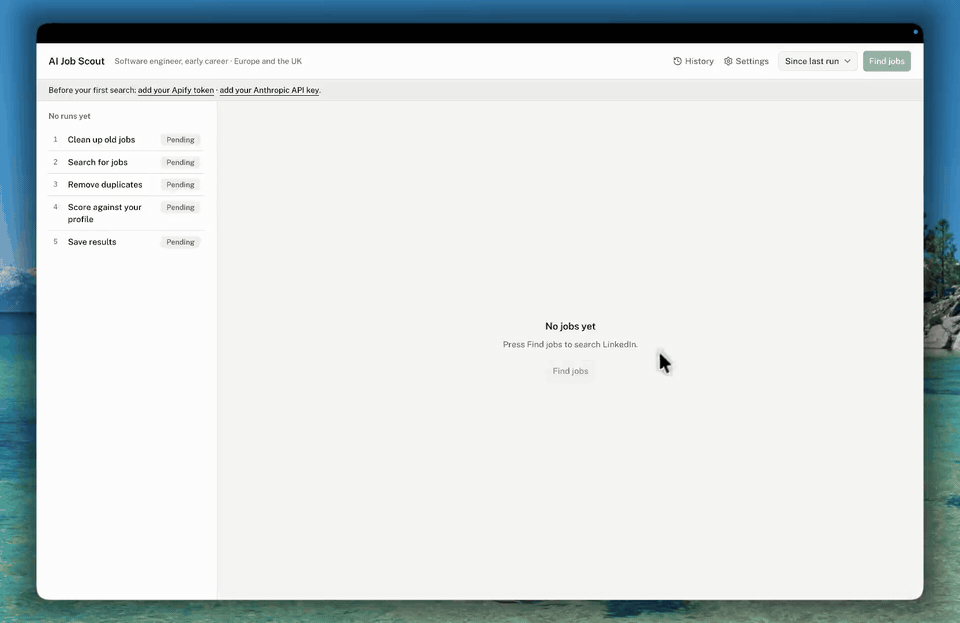
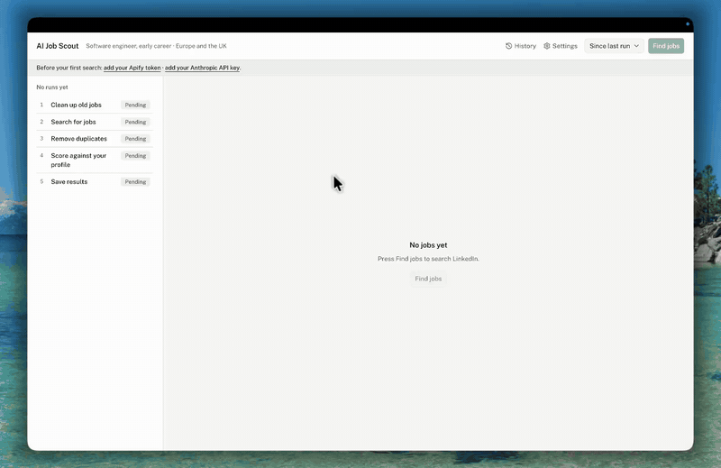
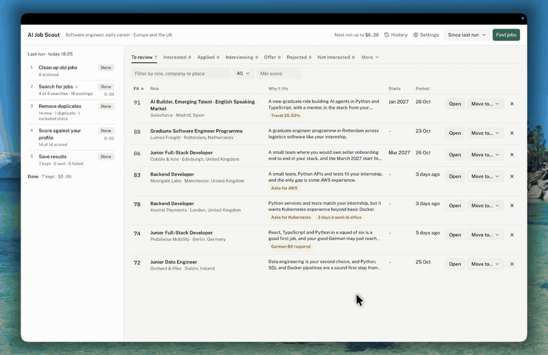
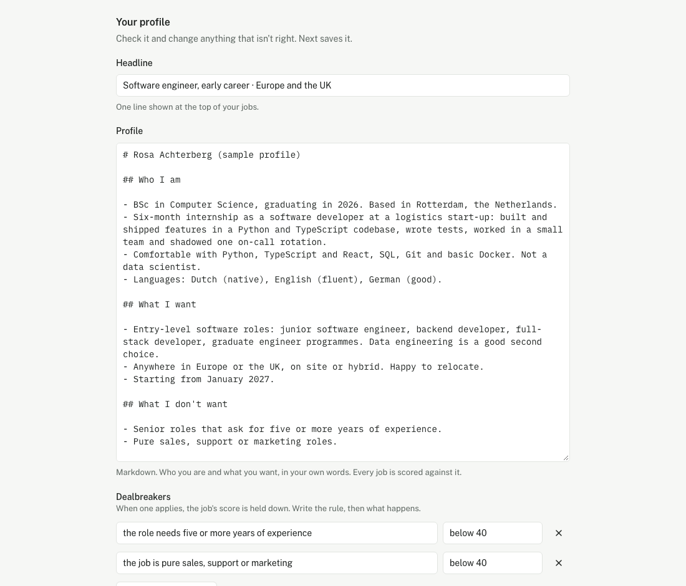
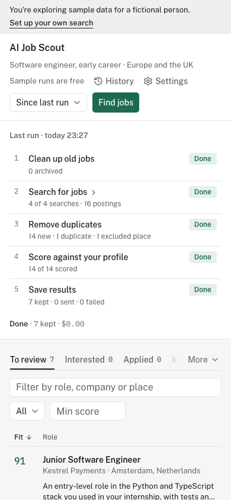

# AI Job Scout

Finds jobs on LinkedIn and Indeed, scores each one against your profile with AI, and keeps a ranked shortlist. Runs on your computer, no coding needed.



## Features

### Use the AI you already have

Pick Claude Code, Anthropic, OpenAI, Google Gemini, OpenRouter or Ollama. Paste a key, test it, and the app scores every job with it.


### Search the way you want

Set your job titles, regions and Indeed countries, leave out the places, title words (such as Senior) and posting languages you don't want, and see what a run can cost before you press Find jobs. Jobs left out this way are dropped before scoring, so the AI never reads them.



### A ranked list, with reasons

Every job gets a score, a one-line reason and flags such as "German B2 required". Filter by role, company or place, open the posting, and mark each job Interested, Applied, Interviewing, Offer or Rejected.



## Why it exists

Searching LinkedIn and Indeed by hand means reading a lot of postings that don't fit. AI Job Scout does the searching and the first read for you, so you only look at the jobs worth your time. It's free, it runs on your own computer, and your data stays with you.

## What it does

1. **You describe yourself.** Upload your CV and answer a few questions. The AI drafts a profile, and you check and edit it.
2. **You choose what to search.** Job titles and regions for LinkedIn, plus Indeed if you want it. The Startups tab in Settings adds more places to look for jobs at startups (see below).
3. **It searches.** Press "Find jobs". Apify, a service that runs web scrapers, collects new postings from LinkedIn and Indeed.
4. **It scores.** The AI reads each posting against your profile and gives it a score from 0 to 100, a one-line reason, and flags such as "asks for SQL" or "German B2 required". Your dealbreakers hold a score down.
5. **You review.** Jobs above your minimum score land in a ranked list. Mark each one Interested, Applied, Interviewing, Offer or Rejected, or dismiss it. Optionally, new jobs are also sent to Notion, a CSV file or a webhook.

## Jobs at startups

Settings → Startups adds sources that LinkedIn and Indeed often miss. All are off until you turn them on. The searches and places at the top of the Startups tab apply to every startup source except career pages, which filter by their own title words and places; any source can still have searches or places of its own.

- **Free, read from public job feeds:** Built in Europe (jobs at venture-backed European startups), Jobgether (remote jobs), the job boards venture capital firms run for the startups they back (on Getro or Consider), and the career pages of companies you follow (Ashby, Greenhouse, Lever, Recruitee, Workable, Personio and Teamtailor). They cost nothing to search, and keep only jobs that match your searches so the AI reads as few as possible: recent ones, except career pages, where every open job is read once.
- **Through Apify, paid per job like LinkedIn:** Welcome to the Jungle (including what was Otta), Wellfound, Y Combinator's Work at a Startup, and an index of many companies' own job boards.

When a source states the salary, it is shown with the job and given to the AI.



The layout also works on a phone-sized window:



## Quick start (no terminal)

1. On this page, choose **Code**, then **Download ZIP**, and unzip it anywhere.
2. Double-click **`Start.command`** (macOS) or **`Start.bat`** (Windows).
3. The first launch takes a few minutes. It sets up what the app needs, once. After that it starts in seconds.
4. Your browser opens the app. Follow the setup wizard, or choose **Try it with sample data instead** to look around first with fictional jobs. Sample runs are free and need no keys.

The first time you open the launcher your computer may stop it, because the app isn't from an app store:

- **macOS:** double-click `Start.command` once. When macOS says it can't open it, go to **System Settings, then Privacy & Security**, scroll down to the message about `Start.command` and choose **Open Anyway** (macOS 15 Sequoia and newer). On older macOS, right-click `Start.command`, choose **Open**, then **Open** again.
- **Windows:** in the blue SmartScreen window, choose **More info**, then **Run anyway**.

Keep the launcher window open while you use the app. Closing it stops the app.

## What you need

- **An Apify account.** Apify runs the LinkedIn and Indeed searches, and the paid startup boards. The free plan includes $5 of usage a month. The wizard shows where to find your token. You don't need it if you only use the free startup sources.
- **One AI to read and score the jobs.** Pick one:
  - **Claude Code**: uses your Claude subscription and needs no API key. It must be installed and signed in on your computer.
  - **Anthropic**, **OpenAI**, **Google Gemini** or **OpenRouter**: each needs an API key from that company. Usage is paid per use, and Gemini has a free tier with limits.
  - **Ollama**: runs a model on your own computer. Free, but slower and less accurate than the others.

## What it costs

The app is free. You pay Apify for the searches, and your AI provider for scoring if you use one that charges per use.

Apify charges for each job it finds. The app's default actors cost about **$0.0003 per LinkedIn job** and **$0.00005 per Indeed job** on Apify's free plan (checked November 2026), so a run of those two usually costs well under $1. You can change these prices in Settings if Apify changes them.

The startup boards on Apify cost more per job: about **$0.003** for Welcome to the Jungle and Wellfound, **$0.0001** for Y Combinator and **$0.005** for company job boards. Wellfound also charges **$0.005 for each search**, which the estimate includes, plus Apify platform usage, which it doesn't. The free startup sources cost nothing.

- **The cost is shown before every run.** The top of the main screen says "Next run up to $…", worked out from your keywords, regions and results limits, next to your remaining Apify credit. It is an upper estimate: it assumes every search returns its maximum number of results (only Wellfound's platform usage is left out).
- **You rarely pay twice for the same posting.** Each search only looks back to your last run, and jobs the app has already seen are never scored again. Repeats can still happen in two ways: a small overlap (60 minutes by default) is added to each search so nothing is missed, and two searches (different keywords or regions) can find the same job. The app removes those repeats, but Apify still charges for them.

## Your data stays on your computer

There is no account and no server run by this project. Your settings, profile, keys and jobs are files on your computer:

| System | Folder |
|---|---|
| macOS | `~/Library/Application Support/ai-job-scout` |
| Windows | `%LOCALAPPDATA%\ai-job-scout` |
| Linux | `~/.local/share/ai-job-scout` |

Inside are `settings.json`, `profile.md`, `secrets.json` (your keys) and `jobscout.db` (your jobs), plus a `runtime` folder with the Python the launcher set up. `jobscout paths` prints the exact location (see below). Your keys stay in that folder and are only sent to the service they belong to, such as Apify or your AI provider. The app listens on your own computer only.

**Updating:** download the new ZIP, unzip it, and double-click the launcher. Your data lives outside the app folder, so nothing is lost.

## Sending results elsewhere

Your jobs always appear in the app. Under **Settings, then Outputs** you can also send them to:

- **Notion.** Create an integration at notion.so/my-integrations, add it to a Notion page, and paste its token and the page's link. The app creates the jobs database inside that page for you, then adds each new job to it. Statuses you change in Notion are read back before the next run.
- **CSV file.** Writes your tracked jobs to a spreadsheet file you can open in Excel or Numbers. It can export after every run, and **Settings, then Data** has an Export to CSV button.
- **Webhook.** The app sends one JSON POST per job at or above your minimum score. Jobs below the minimum are sent too if you turn on **Also send jobs below the minimum to your outputs** (under **Settings, then Profile & rules**). After a re-score, jobs that still qualify are sent again with the same `id`, so your automation can update the existing row instead of adding a new one. The body has these fields: `id`, `source`, `job_id`, `title`, `company`, `location`, `salary`, `url`, `score`, `reason`, `flags`, `status`, `start_date`, `deadline`, `posted`, `recruiter`, `recruiter_title`, `recruiter_url` and `keyword`. Use the **Send a test job** button in the app to send a sample job while you set up the receiving end.

Webhook recipes, to reach Google Sheets, Airtable, Slack, email and more:

- **Zapier:** start a Zap with **Webhooks by Zapier**, event **Catch Hook**. Paste its URL into the app's webhook field and send a test job. Then add an action such as Google Sheets and map `title`, `company`, `score` and `url`. Use an update-or-create row step matched on `id`, so a re-sent job updates its row.
- **Make:** add a **Webhooks, Custom webhook** module and copy its address into the app. Send a test job so Make learns the fields, then connect the next module (Google Sheets, Airtable...) and match rows on `id` so a re-sent job updates its row.
- **n8n:** add a **Webhook** node with method POST and copy its **Production URL** into the app. Activate the workflow, then use the fields from the node's JSON body in the nodes that follow. Use an upsert or update operation keyed on `id` where the node has one.

## For terminal users

The app is a Python package managed with [uv](https://docs.astral.sh/uv/). From the project folder:

```sh
uv run jobscout start      # open the app (--port N, --no-browser, --sample)
uv run jobscout run        # search, score and save new jobs (--window today|week|month|N, --sample)
uv run jobscout estimate   # the most a run can cost, and your Apify credit left
uv run jobscout cleanup    # archive stale jobs (--dry-run only lists them)
uv run jobscout rescore    # score stored jobs again (--yes skips the question)
uv run jobscout export jobs.csv   # write your tracked jobs to a CSV file
uv run jobscout paths      # show where your files are
```

The command line uses the same settings, keys and jobs as the app, so set things up in the app first. `run` prints the most it can cost before it spends anything.

### Run it every day

These run `jobscout run` each morning at 08:00. Replace the folder with where you unzipped the app, and adjust `uv`'s path if `which uv` (macOS, Linux) or `where uv` (Windows) says it lives elsewhere.

**cron (macOS, Linux)**, added with `crontab -e`:

```cron
0 8 * * * cd "$HOME/ai-job-scout" && "$HOME/.local/bin/uv" run jobscout run >> "$HOME/ai-job-scout.log" 2>&1
```

**launchd (macOS)**, saved as `~/Library/LaunchAgents/com.ai-job-scout.daily.plist` and loaded with `launchctl load ~/Library/LaunchAgents/com.ai-job-scout.daily.plist`. Replace `YOU` with your user name:

```xml
<?xml version="1.0" encoding="UTF-8"?>
<!DOCTYPE plist PUBLIC "-//Apple//DTD PLIST 1.0//EN" "http://www.apple.com/DTDs/PropertyList-1.0.dtd">
<plist version="1.0">
<dict>
  <key>Label</key><string>com.ai-job-scout.daily</string>
  <key>ProgramArguments</key>
  <array>
    <string>/bin/zsh</string>
    <string>-c</string>
    <string>cd /Users/YOU/ai-job-scout &amp;&amp; /Users/YOU/.local/bin/uv run jobscout run</string>
  </array>
  <key>StartCalendarInterval</key>
  <dict><key>Hour</key><integer>8</integer><key>Minute</key><integer>0</integer></dict>
  <key>StandardOutPath</key><string>/tmp/ai-job-scout.log</string>
  <key>StandardErrorPath</key><string>/tmp/ai-job-scout.log</string>
</dict>
</plist>
```

If you score with Claude Code, a scheduled run doesn't see your usual `PATH`, so it can't find the `claude` command. Run `which claude` and add its folder. In cron, put a line like this above the job:

```cron
PATH=/Users/YOU/.local/bin:/opt/homebrew/bin:/usr/local/bin:/usr/bin:/bin
```

In the launchd file, add this inside the main `<dict>`:

```xml
<key>EnvironmentVariables</key>
<dict><key>PATH</key><string>/Users/YOU/.local/bin:/opt/homebrew/bin:/usr/local/bin:/usr/bin:/bin</string></dict>
```

**Task Scheduler (Windows)**, from a Command Prompt:

```bat
schtasks /Create /TN "AI Job Scout" /SC DAILY /ST 08:00 /TR "cmd /c cd /d C:\ai-job-scout && uv run jobscout run"
```

Each scheduled run spends Apify credit, so check `jobscout estimate` first. Only one run can be active at a time: if the app is in the middle of a run, the scheduled one says so and stops.

## Troubleshooting

- **The port is busy.** The app starts on port 8765, or the next free one if that's taken. The launcher window prints the address it picked, so open that one. If the app is already running, starting it again just opens the running copy.
- **Apify limit reached.** The message "Apify monthly limit reached" means your plan's monthly usage is used up. It resets on your billing day. Add credit on Apify, or wait. Using fewer keywords, regions or results per keyword also lowers the cost of a run.
- **The AI key was rejected.** Open **Settings, then Keys**, paste the key again, use its Test button, then choose **Save changes**. Check that it's a key for the provider you chose, with no extra spaces.
- **The first launch is slow.** That's normal: it sets up Python and the app's packages once, and needs an internet connection. If it fails, check your connection and open the launcher again.

## Disclaimer

Most searches go through third-party Apify actors, not through this project. The free startup sources are read from the sites' public job feeds or through the same search APIs their own pages use. You are responsible for following each site's terms of service and Apify's terms: Getro, Welcome to the Jungle and Wellfound, for example, forbid reading their sites automatically. This project is not affiliated with, endorsed by or sponsored by LinkedIn, Indeed, Apify, Notion, any job board, venture capital firm or AI provider.

## License

[MIT](LICENSE). The fonts and JavaScript libraries in the app keep their own licenses: see [THIRD_PARTY_NOTICES.md](THIRD_PARTY_NOTICES.md). Questions and bug reports: [open an issue](https://github.com/leopierini/ai-job-scout/issues).

To get the code with git instead of the ZIP: `git clone https://github.com/leopierini/ai-job-scout.git`
